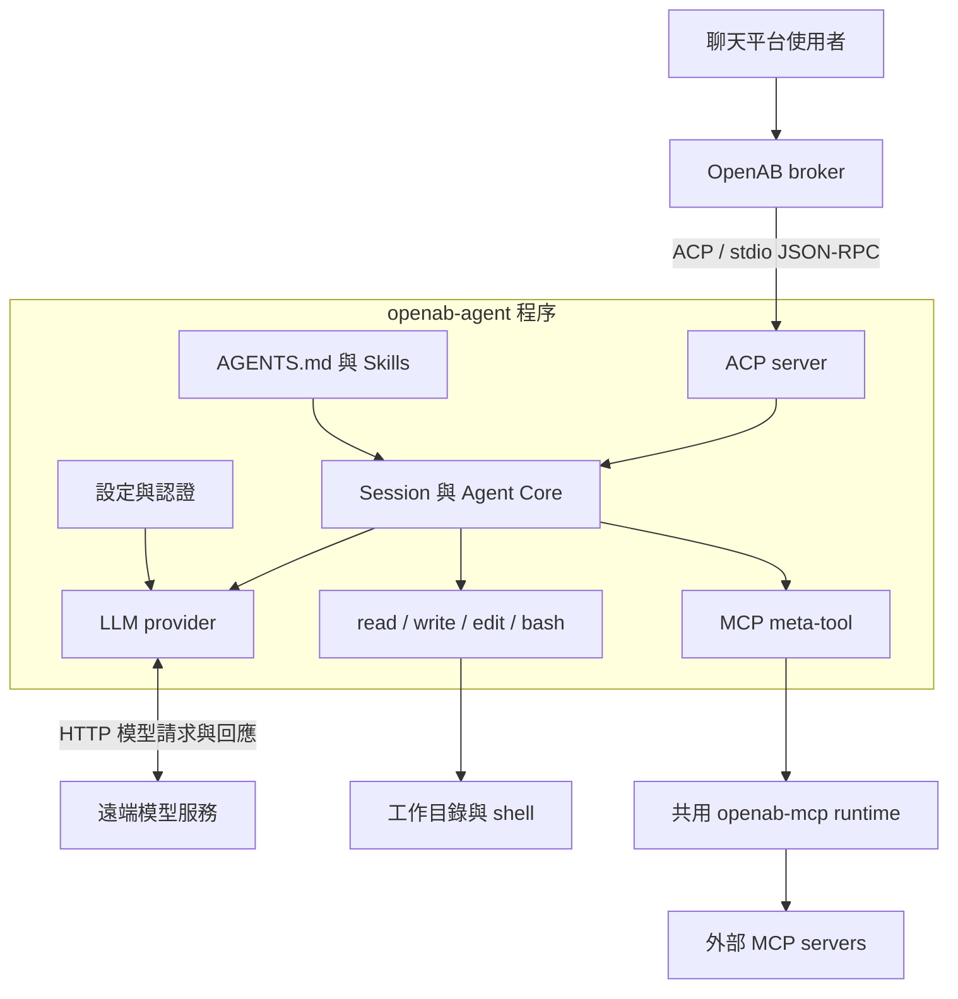

# openab-agent：用途、架構與主要元件

本文件根據本機 checkout `6431a1b6` 的程式碼整理。它描述已實作的行為；原始 [ADR](adr/openab-agent.md) 的構想另列於下方，不能直接當成目前的功能清單。

## 它是什麼？

`openab-agent` 是 OpenAB 自己實作的 Rust coding agent。它接收任務、呼叫語言模型、執行檔案與 shell 工具，把執行結果送回模型，直到產生回答。

外層 `openab` 是 broker，負責聊天平台接入、訊息路由與 agent 連線；`openab-agent` 則負責實際的模型與工具執行循環。部署可以選擇其他 coding CLI，也可以選擇這個原生 agent。

`openab-agent` 本身提供 ACP server，省去外部 coding CLI 所需的 ACP wrapper。它仍使用遠端模型服務；原生 Rust 指的是 agent 執行程式，而不是在本機執行模型。

無參數啟動會進入 stdin/stdout JSON-RPC server；另外提供 `auth` 與 `mcp` 管理子命令。參見 [main.rs](../openab-agent/src/main.rs)。

## 系統位置與執行路徑

典型的一次任務如下：

1. ACP client 透過 `session/new` 建立 session，server 建立對應的 `Agent`。
2. `session/prompt` 的文字加入該 session 的歷史。
3. Agent 把 system prompt、歷史與工具定義交給 model provider。
4. 模型要求工具時，Agent 執行工具並把結果加入歷史，再呼叫模型。
5. 模型回覆不包含工具呼叫時，Agent 回傳最終文字，ACP server 發送 `session/update` 與 `end_turn`。

核心迴圈位於 [Agent::run](../openab-agent/src/agent.rs)。工具依序執行，預設最多 50 輪，可透過 `OPENAB_AGENT_MAX_TOOL_LOOPS` 調整。

## 主要元件

| 元件 | 職責 | 主要原始碼 |
|---|---|---|
| CLI 入口 | 預設啟動 ACP；提供認證與 MCP 診斷、登入等子命令 | [main.rs](../openab-agent/src/main.rs) |
| ACP server | JSON-RPC 分派、session 建立與載入、prompt 處理、模型設定與回覆封裝 | [acp.rs](../openab-agent/src/acp.rs) |
| Agent Core | 保存對話、組合 system prompt、執行模型與工具循環、裁剪歷史 | [agent.rs](../openab-agent/src/agent.rs) |
| LLM providers | 將共用訊息與工具格式轉成各服務的 HTTP 請求，解析模型結果 | [llm.rs](../openab-agent/src/llm.rs) |
| 內建工具 | `read` 讀檔／列目錄；`write` 建立／覆寫；`edit` 精確字串替換；`bash` 執行 shell | [tools.rs](../openab-agent/src/tools.rs) |
| Skills 與專案指示 | 載入工作目錄的 `AGENTS.md`；探索 skill 名稱與描述，完整內容按需讀取 | [skills.rs](../openab-agent/src/skills.rs)、[agent.rs](../openab-agent/src/agent.rs) |
| MCP 整合 | 用單一 `mcp` meta-tool 探索 server、列出／描述／呼叫工具、查詢狀態 | [meta_tool.rs](../crates/openab-mcp/src/mcp/meta_tool.rs)、[runtime.rs](../crates/openab-mcp/src/mcp/runtime.rs) |
| 設定與認證 | 模型與 token 上限設定；OAuth 登入、憑證儲存與更新 | [config.rs](../openab-agent/src/config.rs)、[共用 auth.rs](../crates/openab-mcp/src/auth.rs) |

### 模型服務與認證

目前有三個具體 provider：`AnthropicProvider`、`OpenAiProvider`、`XaiProvider`。其中 OpenAI 路徑使用 Codex／ChatGPT 訂閱認證；不能僅憑類別名稱推論它已支援任意 OpenAI-compatible endpoint。

Anthropic 支援 API key、預先提供的訂閱 token，以及儲存的 OAuth 認證。Codex 與 xAI 有各自的登入流程。帳密存於 `auth.json`；非機密模型設定放在 `config.json`，支援 `model` 與 `max_tokens`，環境變數可覆蓋檔案設定。操作方式見 [Native Agent 使用指南](native-agent.md)。

### MCP 與 Skills 的界線

Skill 提供「如何做某類任務」的指示。Agent 在 session 建立時將其名稱與描述放入 prompt，需要完整指示時再使用 `read` 讀取。搜尋順序為專案 `.openab/skills/`，再到 `~/.openab/agent/skills/`。

MCP 提供可呼叫的外部能力。模型透過單一 `mcp` 工具的 `list_servers`、`list_tools`、`describe_tool`、`call`、`status` 等動作逐步探索，避免一開始載入所有外部工具 schema。

MCP runtime 與認證層已抽到共用的 `crates/openab-mcp`，供 agent 與 broker 重用。Agent 內的 `auth.rs` 與 `mcp.rs` 是重匯出介面；實際 runtime 包含連線、OAuth、故障斷路與閒置回收。這是程式碼重用，不代表兩個程序共用同一份記憶體。

## 現有實作的邊界

| 面向 | 程式碼中的現況 |
|---|---|
| Session | `HashMap<String, Agent>` 保存於程序記憶體；每個 Agent 使用平面的訊息列表 |
| 恢復 | `session/load` 可重新連接同一程序已知的 session；沒有跨程序重啟的歷史持久化 |
| Context 管理 | 超過 100 則訊息時刪除較舊訊息並保留第一則使用者訊息；不是 token 精算或模型摘要 |
| 串流 | ACP initialize 宣告 `streaming: false`；prompt 完成後才送出最終文字 update |
| 取消 | `session/cancel` 尚有 TODO，沒有中止執行中的 Agent loop |
| 輸入 | ACP prompt handler 目前抽取文字區塊；不能推論具有完整多模態支援 |
| 檔案安全 | `read/write/edit` 透過路徑正規化限制在工作目錄內 |
| Shell 安全 | 過濾環境變數、預設 120 秒 timeout、Unix process group 清理；shell 仍有一般 OS 權限，不能視為完整 sandbox |
| 建置 | `openab-agent` 目前被根 workspace 排除，需依使用指南在子目錄建置；透過 path dependency 使用共用 crate |

原始 ADR 描述的 session tree、自動摘要、Google provider、bubblewrap sandbox 與 in-process library mode，不應列為目前已完成能力。相反地，OAuth、Skills 與 MCP 已有現行程式碼，早期 ADR 對它們的缺口描述已不代表現況。

## 研究範圍

這次為靜態程式碼與文件交叉檢查，未執行模型服務整合測試，亦未驗證文件中的映像大小、啟動時間或記憶體效能數字。沒有新的架構選擇，因此未新增 ADR。專案術語見 [CONTEXT.md](../CONTEXT.md)。
